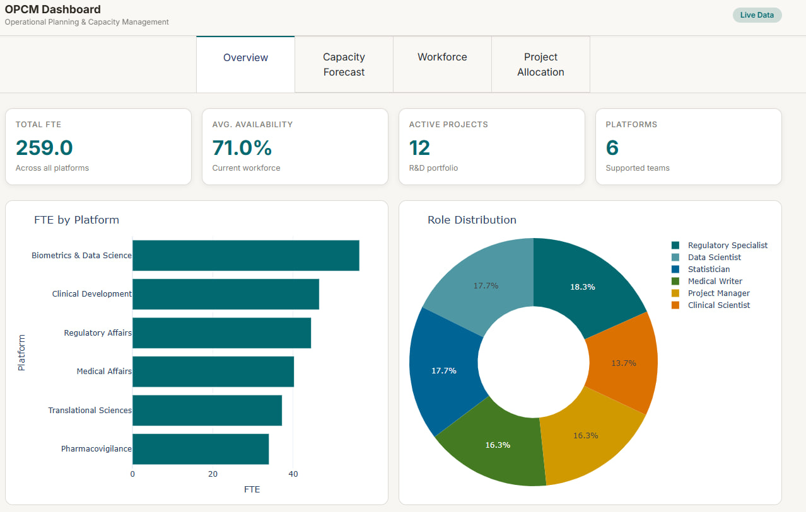
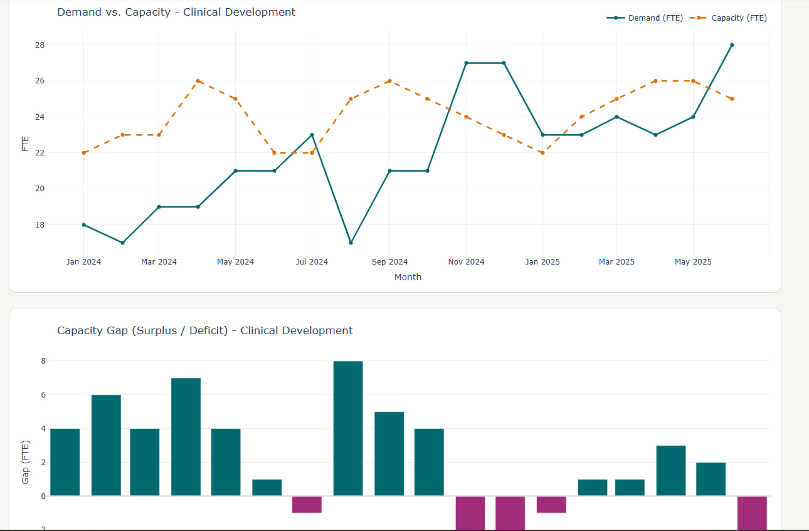
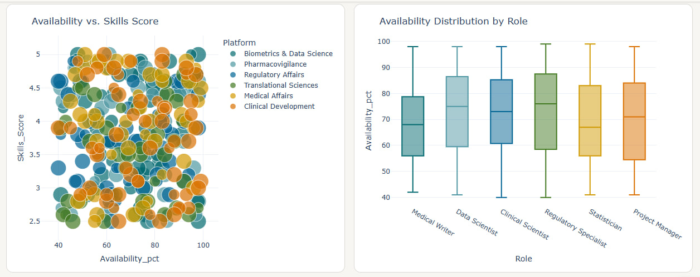
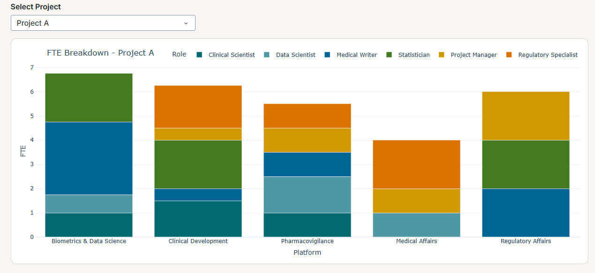

# OPCM Workforce and Capacity Planning Dashboard

## Overview

This is an interactive web application built with Python Dash for visualizing workforce data and capacity planning metrics in an R&D organization. The application uses synthetically generated data to simulate realistic operational planning scenarios.






## Requirements

- Python 3.10 or higher
- The following Python packages:

```
dash
dash-bootstrap-components
plotly
pandas
numpy
```

Install all dependencies with:

```
pip install dash dash-bootstrap-components plotly pandas numpy
```

## Running the Application

```
python app.py
```

Once running, open a browser and navigate to:

```
http://127.0.0.1:8050
```

## Application Structure

The dashboard contains four tabs:

| Tab | Description |
|---|---|
| Overview | KPI summary cards, FTE distribution by platform, role breakdown, and availability heatmap |
| Capacity Forecast | 18-month demand vs. capacity trends and gap analysis, filterable by platform |
| Workforce | Scatter and box plots for workforce analysis, with a filterable data table |
| Project Allocation | FTE and headcount distribution across platforms and projects |

## Notes

- All data is synthetically generated on application startup using fixed random seeds.
- No external data files or database connections are required.
- The application runs locally and does not require an internet connection after initial package installation.