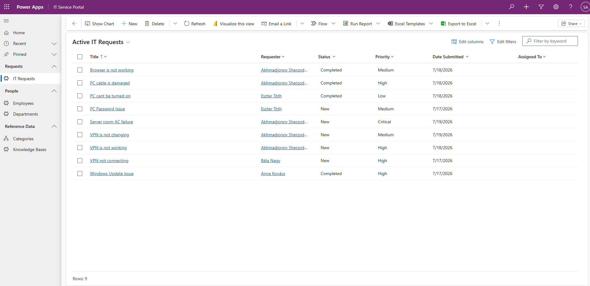
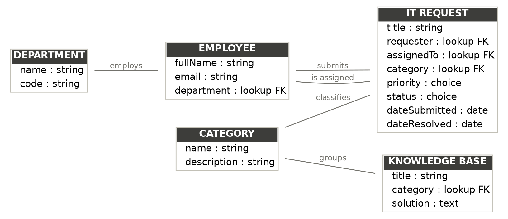
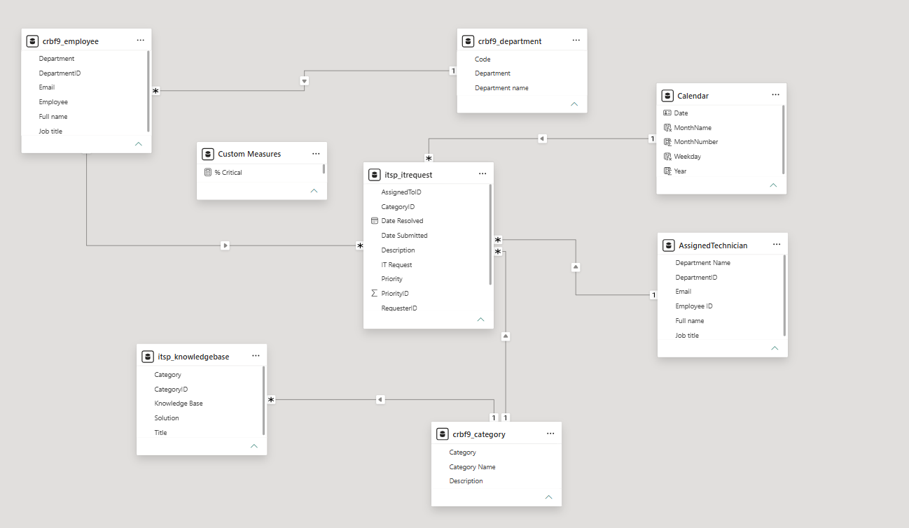
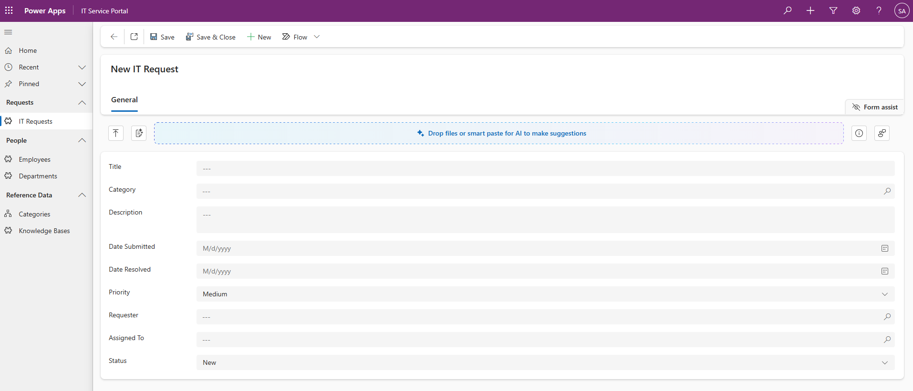
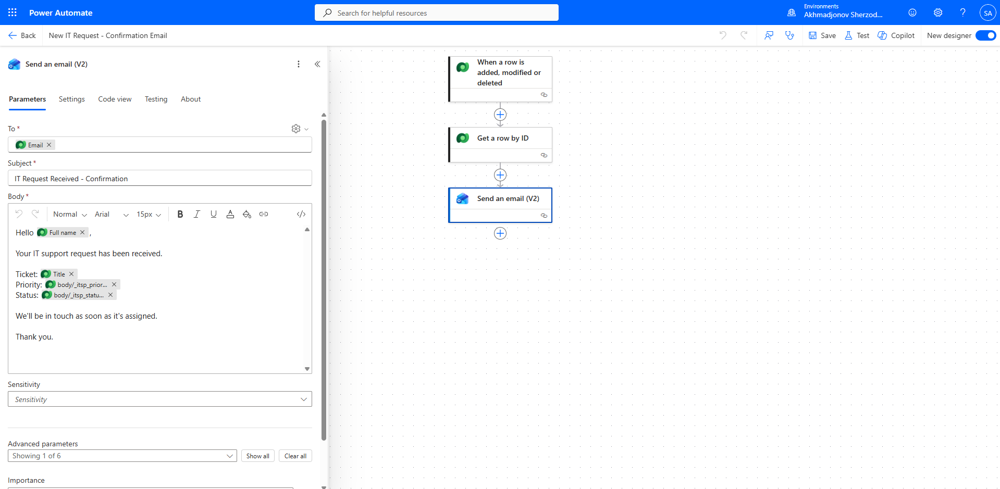
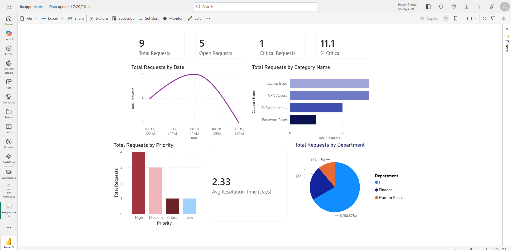

# IT Service Portal

An end to end enterprise IT service request platform built on Microsoft Power Platform, covering data modeling, application development, workflow automation, and business intelligence reporting.

## Overview

This project simulates a real internal IT support system: employees submit tickets, IT staff track and resolve them, and management monitors volume, priority, and resolution performance through a live dashboard. It was built to demonstrate a complete low code enterprise stack, from a relational data model through to automated notifications and executive reporting.

## Architecture

The system is built entirely on four connected Power Platform services, each responsible for a distinct layer:

1. **Microsoft Dataverse** stores the data. A relational schema of five custom and reused tables, connected through proper lookup relationships rather than flat text fields.
2. **Power Apps (model driven)** provides the interface. Employees submit and track requests; IT staff manage assignment and status through auto generated, customized forms and views.
3. **Power Automate** handles notifications. Three flows react to ticket creation, priority escalation, and resolution, each sending a real time email.
4. **Power BI** delivers reporting. A star schema model with DAX measures and a dashboard built around specific business questions rather than arbitrary charts.

## Data Model

The Dataverse schema is built around a central IT Request table connected to four supporting tables:

Department holds organizational units. Employee holds staff records, linked to Department by lookup. Category classifies the type of issue. Knowledge Base stores self service articles, linked to Category. IT Request is the core transactional table, linked to Employee twice (as Requester and as Assigned Technician), and to Category once.

The double relationship to Employee required deliberate handling, since Dataverse only allows one active relationship between the same pair of tables by default. This was resolved with a role playing dimension pattern in the Power BI model, where Employee is referenced a second time as a distinct Assigned Technician table, giving each relationship its own honest, active link.

## Application

The Power Apps interface is a model driven app, chosen deliberately over a canvas app to stay close to native Dataverse behavior and to reflect how internal enterprise tools are typically built in practice. Navigation is grouped into Requests, People, and Reference Data. The IT Request form surfaces every relevant field, including both employee lookups and the priority and status choice fields, with the default Owner security field hidden from view since it serves access control rather than business tracking.

## Automation

Three Power Automate flows keep the system responsive without any manual follow up.

The first flow fires when a new request is created and sends a confirmation email to the requester, including the ticket title, priority, and status resolved from Dataverse choice fields into their readable labels.

The second flow fires whenever a request is created or edited and its priority is Critical, alerting IT with the ticket details and the name of the employee who reported it.

The third flow fires when a request's status changes to Completed, notifying the requester that their issue has been resolved.

## Reporting

The Power BI report follows a deliberate pipeline rather than jumping straight to visuals. Data is pulled live from Dataverse, cleaned and typed in Power Query, modeled into a star schema with a dedicated calendar table, and measured with explicit DAX rather than implicit aggregations.

Before any chart was built, a set of business questions was defined first, and each visual exists to answer one of them directly. Current open volume and critical share are shown as KPI cards. Ticket trend over time uses a straight line chart against the calendar table. Issue type and departmental burden use ranked bar charts rather than pie charts, since they scale better as categories grow. Average resolution time is calculated with a filter and iterate pattern in DAX, excluding still open tickets from the average.

## Technologies

Microsoft Dataverse, Power Apps, Power Automate, Power BI, DAX, Power Query M, Microsoft 365.

## Notes on Design Decisions

A few choices in this project were deliberate and are worth calling out for anyone reviewing the schema closely. The Category table reuses a built in Dataverse Knowledge Management entity rather than a fully custom table, a decision made once identified rather than an oversight, and kept for functional simplicity. Choice fields such as Priority and Status retain both a numeric and a label column, which allows correct logical sorting in reports instead of default alphabetical ordering.

## Author

Built by Sherzodbek Akhmadjonov as a self directed portfolio project to practice enterprise low code development and business intelligence reporting.
